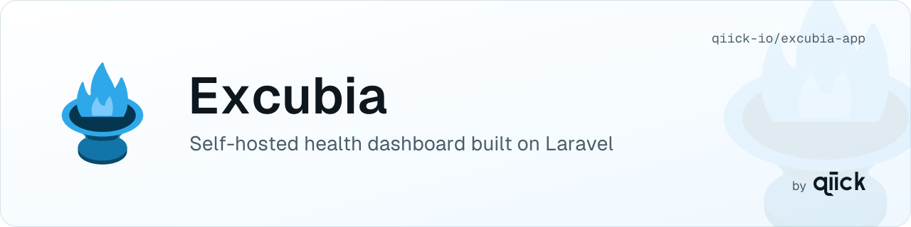

<p align="center">
  <picture>
    <source media="(prefers-color-scheme: dark)" srcset=".github/assets/header-dark.svg">
    <source media="(prefers-color-scheme: light)" srcset=".github/assets/header-light.svg">
    
  </picture>
</p>

# Excubia App

[](./LICENSE)

**Excubia App** is the optional, open-source (MIT), self-hosted Laravel dashboard of [Excubia](https://github.com/qiick-io/excubia-core), part of the [qiick](https://qiick.io) suite. It keeps the health of all your Laravel projects in one place: PHP / Laravel / Node end of life, known vulnerabilities, abandoned and stale packages, next-major blockers and the suggested upgrade order.

It is built on [`qiick/excubia-core`](https://github.com/qiick-io/excubia-core), the Composer package that ships the `excubia` CLI and the checks engine. The app does not reimplement any check. Each monitored project installs `qiick/excubia-core` and pushes its reports to the app with a per-project token, so projects can live anywhere. The app stores the reports and shows them on a dashboard.

> **Status:** early development. Nothing is released yet and it is not ready for production. See the [v0.1.0 milestone](https://github.com/qiick-io/excubia-app/milestone/1) for the plan.

## Planned for v0.1.0

- Register projects with a push token and receive the reports they send (`excubia push`)
- Dashboard: worst severity per project, findings, upgrade plan, report history, stale projects
- Private login with users, groups, roles and permissions, and optional OIDC single sign-on (same model as Externa)
- Self-hosted, no telemetry

Later: opt-in runtime monitoring and exception tracking (sent by `qiick/excubia-core`), alerts, and a hosted version on qiick Cloud.

## Self-hosting

### Requirements

- PHP 8.4 with the `pdo_sqlite` extension (or the driver of the database you use), Composer 2
- Node 24 and npm, to build the frontend
- A web server pointing to `public/` (nginx, Apache, Caddy or Laravel Herd), served over HTTPS: `excubia push` refuses plain HTTP except to localhost
- Cron (or a process manager) for the Laravel scheduler

SQLite is the default database. MySQL, MariaDB and PostgreSQL work too: set `DB_CONNECTION` and the `DB_*` values in `.env`.

### Install

```bash
git clone https://github.com/qiick-io/excubia-app.git
cd excubia-app
composer install --no-dev --optimize-autoloader
cp .env.example .env
php artisan key:generate
```

Edit `.env`: set `APP_ENV=production`, `APP_DEBUG=false` and `APP_URL` to the public HTTPS URL of the app. Projects push to that URL. Then:

```bash
touch database/database.sqlite   # SQLite only
php artisan migrate --force
npm ci && npm run build
php artisan excubia:create-user
```

`excubia:create-user` asks for a name, an email and a password. The first user becomes super-admin. There is no public sign-up, so add more users here or under **Users** in the app.

### Scheduler and queue

The app runs scheduled tasks:

- `excubia:prune-reports` keeps the newest reports of each project (30 by default, in **Settings → Project**);
- `activitylog:clean` trims the activity log.

Run the Laravel scheduler with a cron entry:

```cron
* * * * * cd /path/to/excubia-app && php artisan schedule:run >> /dev/null 2>&1
```

or keep `php artisan schedule:work` running. The app queues no work of its own yet, so a queue worker (`php artisan queue:work`) is optional. Failed jobs, if any, show under **Settings → Jobs**.

### Add a project

1. In the app, open **Projects → New project** and give it a name. The app shows the push token **once**: copy it.
2. In the Laravel project to watch, install the core package. You need a version with `excubia push`, which comes in 0.2.0:

   ```bash
   composer require qiick/excubia-core
   ```

3. Add the two lines from the token dialog to the project's `.env`:

   ```dotenv
   EXCUBIA_APP_URL=https://excubia.example.com
   EXCUBIA_APP_TOKEN=excubia_…
   ```

4. Schedule the push in the project's `routes/console.php`, and keep that project's scheduler running too:

   ```php
   use Illuminate\Support\Facades\Schedule;

   Schedule::command('excubia:push')->daily();
   ```

Run `php artisan excubia:push` once to send the first report. A project that has not reported for 36 hours (setting in **Settings → Project**) shows as stale. Lost the token? Use **New push token** on the project row. **Revoke** stops pushes until you issue a new one. For the project side (CI pushes, `--strict`, exit codes), see [`qiick/excubia-core`](https://github.com/qiick-io/excubia-core#readme).

### Update

```bash
php artisan down
git pull
composer install --no-dev --optimize-autoloader
php artisan migrate --force
npm ci && npm run build
php artisan optimize
php artisan up
```

### Privacy

- Projects send their reports only to this app, authenticated by their own token.
- The checks run inside each project, through `qiick/excubia-core`. They send only package names and versions to public data sources.
- The app itself calls nothing outside your server except the mail server and the OIDC provider you configure.
- No telemetry and no third-party trackers.

## Stack

PHP 8.4, Laravel 13, Inertia, React 19, TypeScript, Tailwind CSS v4, Pest, Pint, Larastan — the same stack as [Externa](https://github.com/qiick-io/externa-core).

## Contributing

Open or pick an issue first; one issue per pull request, branches from `develop`, Conventional Commits. Details will land in `CONTRIBUTING.md`.

## License

[MIT](./LICENSE)
